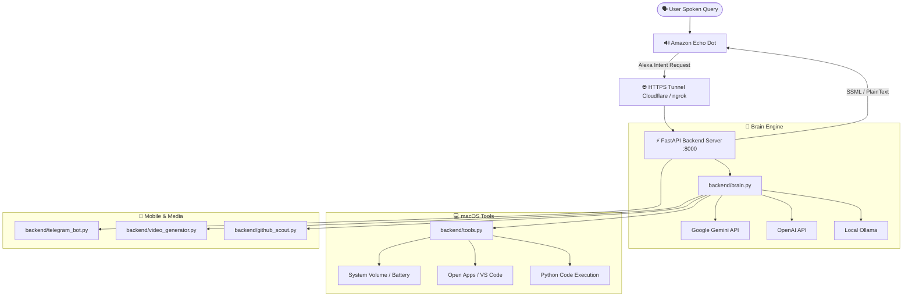

<div align="center">

# 🎙️ J.A.R.V.I.S. — Echo Dot & macOS AI Assistant

**Turn any Amazon Echo Dot into a subscription-free, multi-model LLM Jarvis assistant with native macOS system automation and Telegram remote uplink.**

[](https://python.org)
[](https://fastapi.tiangolo.com)
[](https://developer.amazon.com/alexa)
[](https://aistudio.google.com)
[](https://platform.openai.com)
[](LICENSE)
[](README_TR.md)
[](AI_CUSTOMIZATION_GUIDE.md)

[Features](#-key-features) • [Architecture](#-architecture) • [Quickstart](#-quickstart-guide) • [AI Customization](AI_CUSTOMIZATION_GUIDE.md) • [Alexa Setup](#-amazon-alexa-skill-setup) • [Telegram Uplink](#-telegram-remote-uplink) • [Documentation](#-documentation)

</div>

---

## 💡 Overview

Amazon Echo devices are often limited by commercial prompts asking for Amazon Music or Audible subscriptions. **J.A.R.V.I.S.** bypasses these restrictions entirely by operating your Echo Dot in **Amazon Developer Mode**:

1. You say *"Alexa, open Jarvis"*.
2. Echo Dot streams speech-to-text directly to your local FastAPI backend.
3. The cognitive brain routes queries through **Google Gemini**, **OpenAI**, or **local Ollama**.
4. Actions execute directly on your Mac (volume, apps, code execution, media).
5. The response is spoken through Echo Dot's speaker in charismatic, conversational dialogue.

> [!NOTE]
> Zero subscriptions required. Works seamlessly with older Echo Dot generations (Gen 2, 3, 4, 5) and macOS systems.

---

## ⚡ Key Features

### 🧠 Multi-Model Cognitive Routing
- **Google Gemini (Recommended):** Ultra-low latency responses using `gemini-flash-lite-latest` or `gemini-2.5-flash` on the free tier.
- **OpenAI:** Seamless fallback to `gpt-4o-mini` if Gemini quota is reached.
- **Local Ollama:** Run 100% offline models (e.g. `llama3:latest`, `mistral`) without sending telemetry to external clouds.
- **Hot-Switching:** Voice commands like *"switch to ChatGPT"* or *"switch to Gemini"* instantly change the neural provider on the fly.

### 💻 Native macOS Automation & CodeAct
- **System Controls:** Control Mac system volume, check battery level, and query real-time weather via free Open-Meteo API.
- **Universal App Launcher:** Fuzzy application opening via macOS AppleScript (`open -a "Visual Studio Code"`, Spotify, Chrome, Terminal, etc.).
- **Code Generation & Execution:** Ask Jarvis to build scripts. It writes clean Python code directly to `~/Desktop/` and automatically opens it in VS Code.
- **Iconic Protocols:** *"Daddy's Home"* protocol sets volume to 80% and engages AC/DC's Back in Black.

### 📱 Telegram Remote Uplink
- **Mobile Companion:** Send voice notes and text messages to your personal Telegram bot while away from home.
- **Voice Transcription:** Transcribes `.ogg` Telegram voice notes using multimodal Gemini audio processing.
- **Instant Media Push:** Any code script, screenshot, or generated video is automatically delivered directly to your phone.

### 🎬 Viral Shorts & Video Engine
- **Full-Screen 9:16 Vertical:** Automated formatting to 1080x1920 with safe-zone positioning.
- **Pro Cinematic Stack:** Places widescreen 16:9 action in the center with an ambient glassmorphic background—no cut-off subjects or blind zooms.
- **Dynamic Trending Music:** Downloads and mixes topic-specific trending audio tracks under dialogue (make sure you have the rights to the music you use).
- **Kinetic TikTok Subtitles:** Millisecond-accurate word boundary subtitles rendered via `libass`.
- **Monetization Optimized:** 65-second duration matching the TikTok Creator Rewards program standard (>60 seconds).

### 🎓 Interactive Language Tutor & GitHub Scout
- **Language Practice:** Interactive tutoring with phonetic attempt evaluation and automated study notes.
- **Daily Open-Source Scout:** Curated daily project ideas (AI agents, WebSockets, RAG, automation) with actionable 1-day MVP roadmaps.

---

## 🏗️ Architecture



---

## 🚀 Quickstart Guide

### 1. Clone & Install Dependencies

```bash
git clone https://github.com/YankiOzarslan/alexa-echo-jarvis-prototype.git
cd alexa-echo-jarvis-prototype

# Create virtual environment
python3 -m venv venv
source venv/bin/activate

# Install dependencies
pip install -r requirements.txt
```

### 2. Configure Environment

Copy the example environment file and add your API keys:

```bash
cp .env.example .env
```

Edit `.env`:

```env
AI_PROVIDER=gemini
GEMINI_API_KEY=your_gemini_api_key_here
GEMINI_MODEL=gemini-flash-lite-latest

# Optional: OpenAI fallback
OPENAI_API_KEY=your_openai_api_key_here

# Optional: Telegram mobile companion
TELEGRAM_BOT_TOKEN=your_telegram_bot_token_here
```

### 3. Start the Server

```bash
python3 run.py
```

The server will launch at `http://localhost:8000`. Test it in another terminal:

```bash
curl -X POST http://localhost:8000/test \
     -H "Content-Type: application/json" \
     -d '{"query": "Hello Jarvis, run system diagnostics"}'
```

---

## 🌐 Exposing the Webhook (HTTPS Tunnel)

Alexa requires an active HTTPS URL to reach your local backend. You can use **Cloudflare Tunnel** (recommended, 100% free) or **ngrok**:

### Option A: Cloudflare Tunnel (Free & No Signup)

```bash
brew install cloudflared
cloudflared tunnel --url http://localhost:8000
```

Copy the generated URL (e.g. `https://xxxx-xxxx.trycloudflare.com`). Your webhook endpoint is:
`https://xxxx-xxxx.trycloudflare.com/alexa`

### Option B: ngrok

```bash
cp ngrok.yml.example ngrok.yml
# Add your authtoken to ngrok.yml if you have a static domain
./start_jarvis.sh
```

---

## ☁️ Amazon Alexa Skill Setup

Setting up your private development skill takes about 5 minutes:

1. Open [Alexa Developer Console](https://developer.amazon.com/alexa/console/ask) and sign in with the Amazon account tied to your Echo Dot.
2. Click **Create Skill**:
   - **Name:** `Jarvis`
   - **Default Language:** `English (US)` *(Works for both Turkish & English queries)*
   - **Experience:** `Other` -> `Custom`
   - **Hosting:** `Provision your own`
3. **Upload Interaction Model:**
   - Navigate to **Interaction Model** -> **JSON Editor**.
   - Copy the entire content of [`alexa/interaction_model_en.json`](alexa/interaction_model_en.json) and paste it.
   - Click **Save Model**, then **Build Model**.
4. **Set Webhook Endpoint:**
   - Navigate to **Endpoint** -> select **HTTPS**.
   - Under **Default Region**, paste your tunnel URL with `/alexa`:
     `https://your-tunnel-url.trycloudflare.com/alexa`
   - Select the SSL certificate option:
     *"My development endpoint is a sub-domain of a domain that has a wildcard certificate from a certificate authority"*
   - Click **Save Endpoints**.
5. **Enable Testing:**
   - Go to the **Test** tab at the top.
   - Set **Skill testing is enabled in:** to **`Development`**.
6. **Done!** Your Echo Dot is now linked. Speak:
   > *"Alexa, open Jarvis"*

---

## 📱 Telegram Remote Uplink

To control Jarvis from your smartphone:

1. Create a bot using [@BotFather](https://t.me/BotFather) on Telegram and copy the token.
2. Add `TELEGRAM_BOT_TOKEN` to your `.env` file.
3. Restart Jarvis. The bot will automatically initialize.
4. Send `/start` or a voice note to your bot. Jarvis will pair with your chat ID and synchronize with your Mac.

---

## 🤖 AI-Assisted Customization

Want to adapt this codebase for Windows/Linux, change Jarvis's personality, connect Home Assistant smart lights, or add DeepSeek / Claude models using **Gemini**, **Claude**, **ChatGPT**, or **Cursor**?

We prepared a dedicated guide with ready-to-use prompts:
👉 **[Read the AI Customization Guide & Prompt Book (AI_CUSTOMIZATION_GUIDE.md)](AI_CUSTOMIZATION_GUIDE.md)**  
🇹🇷 **[Yapay Zeka ile Özelleştirme Rehberi ve Hazır Promptlar (YAPAY_ZEKA_OZELLESTIRME_REHBERI.md)](YAPAY_ZEKA_OZELLESTIRME_REHBERI.md)**

---

## 📂 Project Structure

```
.
├── alexa/
│   ├── interaction_model_en.json # Complete Alexa Custom Skill interaction model
│   └── skill_manifest.json       # Alexa Skill manifest configuration
├── backend/
│   ├── brain.py                  # Cognitive multi-model LLM router & memory
│   ├── config.py                 # Central environment & credentials manager
│   ├── german_tutor.py           # Multi-turn language tutoring engine
│   ├── github_scout.py           # Daily open-source project curator
│   ├── server.py                 # FastAPI webhook & Alexa JSON parser
│   ├── telegram_bot.py           # Remote Telegram bot & voice transceiver
│   ├── tools.py                  # Native macOS automations & CodeAct runner
│   └── video_generator.py        # 9:16 Shorts/TikTok video rendering engine
├── .env.example                  # Documented environment variables template
├── .gitignore                    # Production gitignore protecting secrets & media
├── AI_CUSTOMIZATION_GUIDE.md     # AI prompt book & architecture map (English)
├── YAPAY_ZEKA_OZELLESTIRME_REHBERI.md # Yapay zeka ile geliştirme rehberi (Türkçe)
├── SETUP_GUIDE.md                # Step-by-step setup guide (English)
├── KURULUM_REHBERI.md            # Adım adım kurulum kılavuzu (Türkçe)
├── LICENSE                       # MIT License
├── README.md                     # International project documentation
├── README_TR.md                  # Türkçe dokümantasyon
├── requirements.txt              # Pinned Python package dependencies
├── run.py                        # Unified launcher with auto-env initialization
└── start_jarvis.sh               # One-click startup script with tunnel automation
```

---

## 🔒 Security & Privacy

- **No Third-Party Telemetry:** All queries are processed directly on your machine and routed to your own configured API keys (or 100% locally via Ollama).
- **Secrets Protection:** `.env` and `ngrok.yml` are strictly excluded in `.gitignore`. Never commit API keys or private tokens.
- **Safe Sandboxing:** Command execution tools utilize timeouts and sanitized execution blocks.

---

## 📄 License

Distributed under the MIT License. See [`LICENSE`](LICENSE) for more information.
