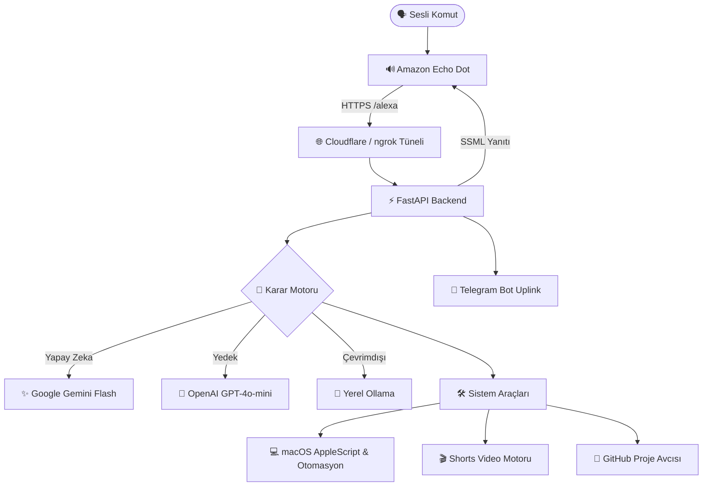

<div align="center">

# 🎙️ J.A.R.V.I.S. — Echo Dot & macOS Yapay Zeka Asistanı

**Herhangi bir Amazon Echo Dot cihazını, hiçbir abonelik ücreti ödemeden; macOS sistem otomasyonu, Telegram uzaktan erişimi ve çoklu LLM (Gemini/GPT/Ollama) beyniyle çalışan gerçek bir J.A.R.V.I.S.'e dönüştürün.**

[](https://python.org)
[](https://fastapi.tiangolo.com)
[](https://developer.amazon.com/alexa)
[](https://aistudio.google.com)
[](https://platform.openai.com)
[](LICENSE)
[](README.md)

[Özellikler](#-temel-özellikler) • [Mimari](#-mimari) • [Hızlı Kurulum](#-hızlı-kurulum) • [Yapay Zeka ile Özelleştirme](YAPAY_ZEKA_OZELLESTIRME_REHBERI.md) • [Alexa Kurulumu](#-amazon-alexa-kurulumu) • [Telegram Botu](#-telegram-uzaktan-erişim)

</div>

---

## 💡 Genel Bakış

Amazon Echo cihazları normal şartlarda kullanıcıyı sürekli Amazon Music veya Audible gibi paralı aboneliklere yönlendirir. **J.A.R.V.I.S.**, Echo Dot cihazınızı **Amazon Geliştirici Modunda (Development Mode)** çalıştırarak bu kısıtlamaları tamamen aşar:

1. *"Alexa, open Jarvis"* dersiniz.
2. Echo Dot sesi metne döker ve yerel FastAPI sunucunuza iletir.
3. Beyin katmanı isteği **Google Gemini**, **OpenAI** veya yerel **Ollama** modeline iletir.
4. Bilgisayarınızda istenen komutlar (ses, uygulama açma, kod yazma, hava durumu) çalıştırılır.
5. Yanıt Echo Dot hoparlöründen seslendirilir.

> [!NOTE]
> Sıfır maliyetlidir. Echo Dot 2, 3, 4 ve 5. nesil cihazlarla ve macOS sistemlerle uyumludur.

---

## ⚡ Temel Özellikler

### 🧠 Çoklu Model Yönlendirme (Multi-Model Cognitive Routing)
- **Google Gemini (Tavsiye Edilen):** Ücretsiz kotada ultra düşük gecikmeyle yanıt verir (`gemini-flash-lite-latest` veya `gemini-2.5-flash`).
- **OpenAI:** Gemini kotası biterse otomatik olarak `gpt-4o-mini` modeline geçiş yapar.
- **Yerel Ollama:** İnternetsiz ve %100 gizli çalışmak için yerel modelleri destekler.
- **Anlık Model Değiştirme:** *"Switch to ChatGPT"* veya *"Switch to Gemini"* diyerek modeli anında değiştirebilirsiniz.

### 💻 macOS Sistem Otomasyonu
- **Sistem Kontrolleri:** Mac ses seviyesi kontrolü, pil durumu sorgulama ve Open-Meteo ile canlı hava durumu.
- **Uygulama Açıcı:** AppleScript ile herhangi bir Mac uygulamasını (VS Code, Spotify, Chrome vb.) sesle başlatma.
- **Kod Yazma ve Çalıştırma:** Jarvis'ten Python scriptleri yazmasını isteyebilirsiniz. Kodu Masaüstüne kaydeder ve otomatik olarak VS Code'da açar.

### 📱 Telegram Uzaktan Erişim
- **Mobil Asistan:** Evde yokken Telegram botunuza sesli veya yazılı mesaj atabilirsiniz.
- **Ses Transkripsiyonu:** Telegram'dan atılan sesli notları Gemini çok modlu ses işleme ile metne döküp yanıtlar.
- **Medya İletimi:** Üretilen kod dosyaları, ekran görüntüleri veya videolar anında telefonunuza gönderilir.

### 🎬 TikTok / Shorts Video Motoru
- **9:16 Dikey Format:** 1080x1920 dikey video çıktısı.
- **Pro Sinematik Katman:** 16:9 yatay videoları kırpmadan güvenli alanda ortalar ve arkaya ambient blur efekti ekler.
- **Trend Müzik Miksajı:** Konuya özel trend müzikleri indirir ve videonun altına miksler (kullandığınız müziklerin haklarına sahip olduğunuzdan emin olun).
- **Creator Rewards Uyumluluğu:** 65 saniye süreyle TikTok para kazanma şartlarına uyumludur.

---

## 🏗️ Mimari



---

## 🚀 Hızlı Kurulum

### 1. Depoyu İndirin ve Bağımlılıkları Yükleyin
```bash
git clone https://github.com/YankiOzarslan/alexa-echo-jarvis-prototype.git
cd alexa-echo-jarvis-prototype
pip install -r requirements.txt
```

### 2. Ortam Değişkenlerini Ayarlayın
```bash
cp .env.example .env
```
`.env` dosyasını açıp [Google AI Studio](https://aistudio.google.com/)'dan aldığınız ücretsiz Gemini API anahtarınızı girin:
```env
AI_PROVIDER=gemini
GEMINI_API_KEY=your_gemini_api_key_here
GEMINI_MODEL=gemini-2.5-flash
```

### 3. Jarvis'i Başlatın
```bash
python3 run.py
```

### 4. Tüneli Açın
Yeni bir terminalde:
```bash
ngrok http 8000
# veya
cloudflared tunnel --url http://localhost:8000
```

Detaylı Alexa becerisi kurulumu için [KURULUM_REHBERI.md](KURULUM_REHBERI.md) dosyasını inceleyin.

---

## 🤖 Yapay Zeka ile Kendinize Göre Özelleştirin

Bu projeyi Gemini, Claude veya Cursor gibi bir yapay zekaya vererek asistanın ismini, hitap şeklini veya işletim sistemini değiştirebilirsiniz.

👉 **[Yapay Zeka ile Özelleştirme Kılavuzu & Hazır Promptlar (Tıklayın)](YAPAY_ZEKA_OZELLESTIRME_REHBERI.md)**

---

## 📜 Lisans

Bu proje [MIT Lisansı](LICENSE) kapsamında açık kaynak olarak yayınlanmıştır.
